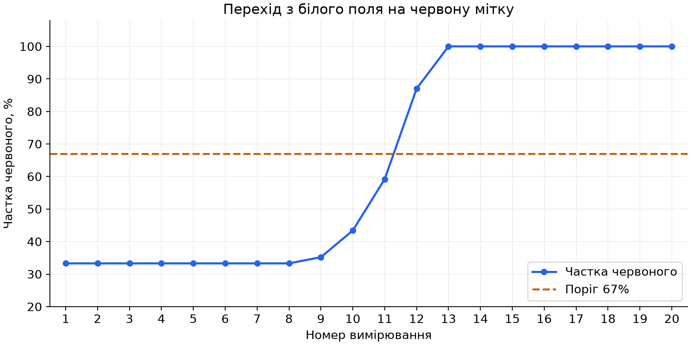

# Покази датчика кольору

**Білик Богдан Вікторович, 416-пр. 26.10.2026.**

Gears, власна сцена `custom_world.json`, датчик кольору на порту 1.
Робот рухався прямо з білого поля на червону мітку зі швидкістю 2%.
Знято 20 показів з паузою 0,5 с між ними.

Показ для порівняння: частка червоного `100 * R / (R + G + B)`, у відсотках.
RGB у таблиці отримано з датчика; частку округлено до одного знака.

| № | Де був датчик | RGB | Частка червоного, % |
|---|---|---|---|
| 1 | Біле поле | 255, 255, 255 | 33,3 |
| 2 | Біле поле | 255, 255, 255 | 33,3 |
| 3 | Біле поле | 255, 255, 255 | 33,3 |
| 4 | Біле поле | 255, 255, 255 | 33,3 |
| 5 | Біле поле | 255, 255, 255 | 33,3 |
| 6 | Біле поле | 255, 255, 255 | 33,3 |
| 7 | Біле поле | 255, 255, 255 | 33,3 |
| 8 | Біле поле | 255, 255, 255 | 33,3 |
| 9 | Межа білого і червоного | 255, 235, 235 | 35,2 |
| 10 | Межа білого і червоного | 255, 166, 166 | 43,4 |
| 11 | Межа білого і червоного | 255, 88, 88 | 59,2 |
| 12 | Межа білого і червоного | 255, 19, 19 | 87,0 |
| 13 | Червона мітка | 255, 0, 0 | 100,0 |
| 14 | Червона мітка | 255, 0, 0 | 100,0 |
| 15 | Червона мітка | 255, 0, 0 | 100,0 |
| 16 | Червона мітка | 255, 0, 0 | 100,0 |
| 17 | Червона мітка | 255, 0, 0 | 100,0 |
| 18 | Червона мітка | 255, 0, 0 | 100,0 |
| 19 | Червона мітка | 255, 0, 0 | 100,0 |
| 20 | Червона мітка | 255, 0, 0 | 100,0 |

**Найменший показ:** 33,3%. **Найбільший:** 100%.

[Програма вимірювання](sensory.py). Перед запуском скинути симуляцію.
