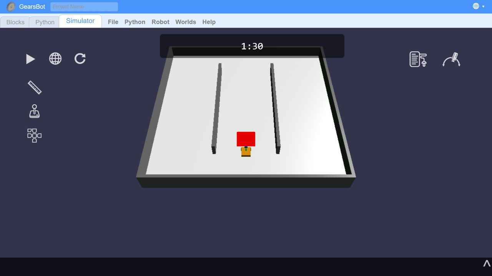

# Практична робота 4. Сенсори

**Білик Богдан Вікторович, 416-пр. Варіант 2-1-1.**

**Датчик:** кольору, порт 1.

**Прогноз:** спочатку очікував відбиття 90-100% на білому та 30-40% на червоному. Пробний проїзд дав 100% на обох поверхнях, тому перейшов до RGB. Перед новим вимірюванням очікував частку червоного близько 33% на білому та 100% на червоному.

**Результат:** 20 показів у русі на швидкості 2%, пауза 0,5 с. Частка червоного: `100 * R / (R + G + B)`. Мінімум 33,3%, максимум 100%, на межі 35,2%, 43,4%, 59,2% і 87%.

[Таблиця та графік](pokazy.md).

**Поріг: 67%.** Якщо частка червоного не менша за 67%, у цій сцені вважаю, що датчик над міткою.

1. Обрав 67% як округлену середину між білим і червоним: `(33,3 + 100) / 2 = 66,65`.
2. Прогноз для RGB підтвердився: отримано 33,3% на білому та 100% на червоному.
3. Поріг може помилитися при зміні кольору освітлення або на сторонній червонуватій поверхні.

**Сцена.** Середовище №1: приміщення з прямими коридорами. Поле 3 × 3 м має зовнішні стіни та дві прямі перегородки довжиною 2 м і висотою 20 см. Робот стартує в центральному коридорі перед червоною міткою 30 × 30 см, яку треба знайти за місією №2. Таймер на 90 с зупиняє робота після завершення часу, що відповідає ускладненню №1.

[Файл сцени практики 4](custom_world.json). 

