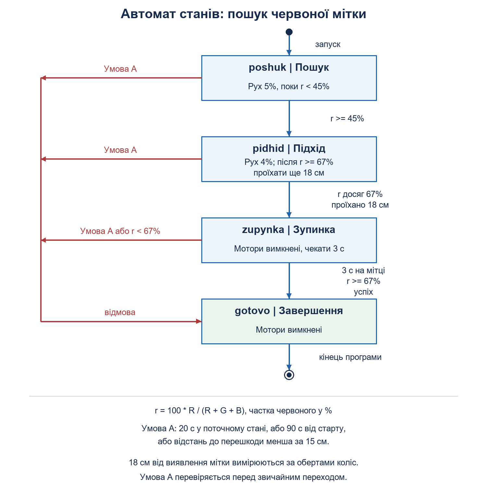

# Практична робота 6. Автомат станів

**Білик Богдан Вікторович, 416-пр. Варіант 2-1-1. 27.10.2026.**

**Дії місії:**

1. Рухатися коридором.
2. Перевіряти відстань до перешкод.
3. Шукати червону мітку датчиком кольору.
4. Сповільнитися та заїхати на мітку.
5. Зупинитися на ній на 3 с.
6. Завершити рух у межах 90 с.

**Фрагмент цієї роботи:** прямий підхід до червоної мітки, заїзд на неї та зупинка на 3 с. Використано [сцену з практики 4](../04-sensory/custom_world.json).

**Стани:** `poshuk -> pidhid -> zupynka -> gotovo`.

У пошуку швидкість 5%. При частці червоного 45% робот сповільнюється до 4%. Коли датчик показує щонайменше 67%, починається відлік ще 18 см за обертами коліс. Після цього робот зупиняється та перевіряє червоне під датчиком протягом 3 с. Діаметр колеса 5,6 см. Частка червоного: `100 * R / (R + G + B)`.

Кожен перехід друкується через `perekhid()`. Таймаут стану 20 с. Перешкода ближче 15 см, втрата мітки під час зупинки або перевищення часу завершують програму з відмовою.

**Перевірка у Gears:**

Час переходів і завершення наведено за журналом програми. Відлік починається після початкової паузи 0,5 с.

| Запуск | Результат |
|---|---|
| Запуск на відео | Підхід на 2,0 с, виявлення мітки на 2,2 с, зупинка на 11,0 с. Під датчиком 100% червоного. Успішне завершення на 14,0 с |
| Перевірка таймаута | Тимчасово встановлено поріг 101%. Через 20 с у стані `pidhid` робот зупинився. Час за журналом програми 22,0 с. Після перевірки повернуто 67% |

**Відео:** 24,07 с. Видно старт, підхід, заїзд на червону мітку та зупинку на 3 с. У кінці програма виводить «Результат: успіх», час 14,0 с. [Переглянути відео](https://drive.google.com/file/d/1l6RI8D_SrR8iQ9a0OIUzzPoX9ojRAkQU/view?usp=sharing).

[Програма](misiya.py).

**Розбір:**

1. У навмисній перевірці застрягав `pidhid`, бо частка червоного не може досягти 101%. Таймаут припинив рух.
2. Друк переходів показує стан і причину його зміни. Це допомагає знайти умову, яка не спрацювала.
3. Для ще двох кроків треба додати стани, умови переходів і таймаути, оновити діаграму та перевірити порядок дій.
