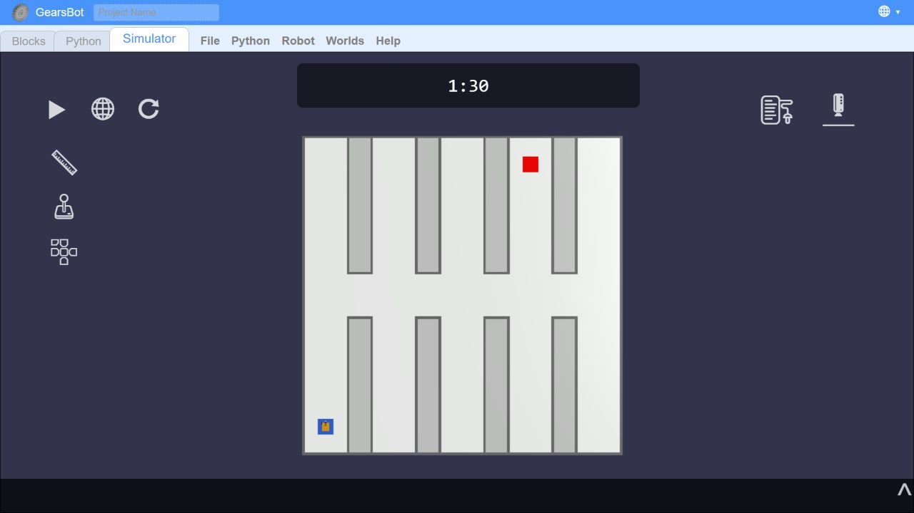

# Практична робота 7. Власна карта

**Білик Богдан Вікторович, 416-пр. Варіант 2-1-1. 27.10.2026.**

**Карта:** приміщення з одним поперечним коридором і десятьма прямими тупиковими гілками, по п'ять із кожного боку. На сполученнях є два Т-перехрестя і три хрестоподібні перехрестя. Червона мітка розташована в глибині однієї з гілок. Датчик кольору спрямований донизу, тому для виявлення мітки треба проїхати над нею.

**Відповідність картці:**

- Місія 2: знайти червону мітку 30 × 30 см серед кількох гілок.
- Середовище 1: приміщення з прямими коридорами, розвилками і тупиками. Помилка можлива, якщо пропустити потрібну гілку або повторно перевіряти порожню.
- Ускладнення 1: таймер світу 90 с зі зупинкою робота. Маршрут до цілі вздовж середини коридорів має довжину 8,9 м. Заїзд до кінця зайвої гілки та повернення додає приблизно 5 м. Тому порядок обстеження впливає на час.

**Розміри:** поле 600 × 600 см. Ширина поперечного коридору й усіх гілок 80 см. Довжина кожної тупикової гілки від краю поперечного коридору до зовнішньої стіни 260 см. Вісім закритих блоків перегородок розміром 50 × 260 см примикають до зовнішніх стін. Висота стін 20 см, товщина 5 см. Старт (-260; -250 см), напрямок 0°; ціль (130; 250 см). Синій квадрат позначає старт. Координати описують карту, GPS у програмі не використовується.

**Прогноз до запусків:** 0 успішних із 3. Код практики 6 їде прямо зі швидкістю 5% та має таймаут пошуку 20 с. Він зупиниться у стартовій гілці до поперечного коридору. Повороти, перевірка інших гілок і повернення з тупиків ще не реалізовані.

**Критерій успіху:**

Робот стартує із синьої зони 30 × 30 см у точці (-260; -250 см), напрямок 0°, самостійно обстежує прямі коридори та знаходить червону мітку 30 × 30 см у точці (130; 250 см). Він зупиняє обидва колеса і стоїть 3 с із датчиком над міткою; частка червоного весь час не менша за 67%. Усе має завершитися не пізніше 90 с без зіткнень і ручного керування у щонайменше 8 прогонах із 10 на зафіксованій карті зі скиданням перед запуском. Провал: перевищення часу, зіткнення, ручне втручання, зупинка поза міткою або втрата червоного протягом 3 с.

**Три прогони:** програма практики 6 без змін. Швидкості 5% і 4%, пороги 45% і 67%, таймаут стану 20 с. Перед кожним запуском симуляцію скинуто. Час у таблиці та в перевірці чужої карти наведено за журналом програми: відлік починається після початкової паузи 0,5 с.

| Прогін | Критерій виконано | Час, с | Що завадило |
|---|---|---|---|
| 1 | Ні | 20,0 | Таймаут пошуку 20 с у стартовій гілці |
| 2 | Ні | 20,0 | Таймаут пошуку 20 с у стартовій гілці |
| 3 | Ні | 20,0 | Таймаут пошуку 20 с у стартовій гілці |

Отримано 0 успішних із 3. Прогноз підтвердився: робот зупинився до поперечного коридору та не знайшов ціль.

**Розбір:**

1. Найважче місце: розвилки поперечного коридору. Треба перевіряти гілки, розвертатися в порожніх тупиках і не повторювати вже пройдені ділянки. Поточна програма цього ще не вміє.
2. Ліміт 90 с обмежує час пошуку. Заїзди до порожніх гілок збільшують шлях. У цих трьох прогонах раніше спрацював таймаут пошуку 20 с, тому проходження всієї карти та запас часу до 90 с ще не виміряні.
3. Карта одногрупника: **Фащенко Данило Тарасович**, файл [карти](custom_world_fashchenko.json), отриманий як `custom_world (finaliteration).json`. Код і налаштування карти не змінювалися. Після виїзду із зеленої стартової зони, біля нижнього правого кута карти, робот помилково сприйняв дерев'яну підлогу як ознаку цілі: на 4,2 с частка червоного становила 46,7%, відбувся перехід `poshuk -> pidhid`. Червоної мітки під роботом не було, поріг 67% не підтвердив її. Через 20 с у стані `pidhid` спрацював таймаут. Час за журналом програми 24,2 с, результат: не виконано. Поріг 45%, підібраний на білому полі, дає хибне спрацювання на іншій підлозі. У стані `pidhid` також немає повернення до пошуку після такого спрацювання.
